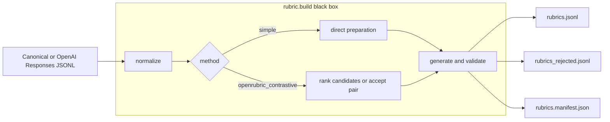

# Rubric generation

NVFlow exposes rubric generation as recipe-independent shared stages. A project selects the
method and maps its source fields into a small portable contract; downstream SFT, RL, and
evaluation integrations consume the same rubric artifact.

## Data flow



The platform stages are:

- `rubric.build`: the normal public interface that performs the full generation flow;
- `rubric.normalize`: map project fields into the canonical contract;
- `rubric.prepare_method`: pass direct inputs through or rank candidate answers; and
- `rubric.generate`: generate, parse, structurally validate, and publish rubrics.

## Canonical input contract

The normalized fields are:

```json
{
  "id": "question-123",
  "question": "What changed and why?",
  "context": "Source material",
  "reference_answer": "Supported answer",
  "candidate_answers": ["candidate A", "candidate B"],
  "preferred_index": 0,
  "metadata": {}
}
```

`simple` requires `question`, `context`, and `reference_answer`.
`openrubric_contrastive` additionally requires either:

- `candidate_answers` plus `preferred_index`, or
- a supplied `preferred_answer` and `rejected_answer` pair.

Structured contexts are serialized as stable JSON before prompting. This makes the contract
usable by text recipes while allowing a project adapter to render multimodal or domain-specific
evidence first.

## OpenAI Responses input

`rubric.normalize` accepts either the canonical contract or serialized OpenAI Responses-style
request/result records. Select the adapter with `input_format: openai_response` (the singular
alias) or `input_format: openai_responses`. The downstream rubric artifact is identical, so no
generation, verifier, or GRPO code changes are required.

A Simple record may use the response itself as the reference answer:

```json
{
  "rubric_context": "Authoritative source or retrieved evidence",
  "responses_create_params": {
    "input": [
      {"role": "user", "content": [{"type": "input_text", "text": "What changed?"}]}
    ]
  },
  "response": {
    "id": "resp_123",
    "output": [
      {
        "type": "message",
        "role": "assistant",
        "content": [{"type": "output_text", "text": "Supported reference answer"}]
      }
    ]
  }
}
```

The adapter extracts:

- `question` from the last user input message;
- `reference_answer` from the final assistant message, direct `output_text`, or a final tool-call
  argument named `final_result`, `answer`, `result`, or `output`; and
- `id` from the record or response ID.

Context remains an explicit rubric input. Supply `context`, `rubric_context`,
`metadata.rubric.context`, or map another field with `field_map`. The adapter deliberately does
not treat model output as authoritative context. An explicit `expected_answer` or
`reference_answer` also overrides the extracted response answer.

For OpenRubric, serialize the competing outputs under `candidate_responses` (the aliases
`responses` and `rollouts` also work) and provide `preferred_index`/`selected_index`:

```json
{
  "context": "Authoritative evidence",
  "expected_answer": "Preferred answer",
  "responses_create_params": {
    "input": [{"role": "user", "content": "Which answer is supported?"}]
  },
  "candidate_responses": [
    {"output": [{"type": "message", "role": "assistant", "content": "Rejected answer"}]},
    {"output": [{"type": "message", "role": "assistant", "content": "Preferred answer"}]}
  ],
  "preferred_index": 1
}
```

This is a JSONL adapter, not an API client: each line is one already-collected request/result
record. It contains no finance-specific field or prompt assumptions.

## Reusable stage

`rubric.build` is the reusable black box and lives in `nvflow/stages/rubric_generation`.
NVFlow executes every stage through a project workflow, so projects add this stage to their own
workflow rather than inheriting a platform-owned runnable YAML. The stage owns its intermediate
files and internal task dependencies:

```yaml
workflow:
  name: rubric_generation
  type: sdg_postprocess

method: simple
input_format: openai_responses
base_output_dir: /workspace/outputs/my-project/rubrics

pipeline_stages:
  - build_rubrics

stages:
  build_rubrics:
    uses: rubric.build
    contract_version: 1
    input_file: /data/questions.jsonl
    output_dir: ${base_output_dir}
    method: ${method}
    input_format: ${input_format}
    field_map:
      id: uuid
      question: problem
      context: context
      reference_answer: expected_answer
      candidate_answers: solutions
      preferred_index: selected_index
    stage_kwargs:
      model: /models/rubric-generator
      server_type: sglang
      server_gpus: 8
      server_nodes: 2
      num_chunks: 8
```

For candidate-ranked contrastive generation, set:

```yaml
method: openrubric_contrastive

stages:
  build_rubrics:
    strategy: rank_candidates
    stage_kwargs:
      model: /models/rubric-generator
      server_type: sglang
      server_gpus: 8
      server_nodes: 2
      num_chunks: 8
```

Use `strategy: direct` with `openrubric_contrastive` when the input already provides the
preferred and rejected answers.

The generation model is configuration, not part of the method. Both methods may therefore use
the same model checkpoint. A controlled RL comparison must separately pin the same policy
starting checkpoint, data split, validation set, and verifier.

For a bounded smoke run, set `max_records` on `rubric.build`. Both arms must read the same
ordered source file and use the same limit so they exercise the same questions. The historical
finance ranking input is supported directly: `source_id`, `candidate_answers`, and
`selected_index` normalize to `id`, `candidate_answers`, and `preferred_index`.

The lower-level `rubric.normalize`, `rubric.prepare_method`, and `rubric.generate` stages remain
available for debugging and specialized workflows. Normal consumers should use `rubric.build`.

## Output contract

Every accepted row has one rubric and method-independent fields:

```json
{
  "rubric_schema_version": 1,
  "id": "question-123",
  "question": "What changed and why?",
  "context": "Source material",
  "reference_answer": "Supported answer",
  "rubric_method": "simple",
  "rubric": [
    {
      "id": "R1",
      "type": "fact",
      "criterion": "States the supported fact",
      "severity": 2,
      "must_pass": true,
      "evidence_summary": "The context directly states the fact"
    }
  ],
  "metadata": {},
  "provenance": {
    "method": "simple",
    "model": "/models/rubric-generator",
    "prompt": "default prompt path",
    "source_sha256": "...",
    "context_sha256": "..."
  }
}
```

The stage also writes:

- `rubrics_rejected.jsonl`, containing parse or schema failures; and
- `rubrics.manifest.json`, containing counts, validity rate, severity distribution, model and
  prompt provenance, and an output hash.

## Validation boundary

Deterministic validation checks JSON structure, unique criteria and IDs, severity values,
Boolean `must_pass`, and the existence of at least one must-pass criterion. Ranking validation
checks complete permutations, candidate indices, material contrast, and that the preferred
answer was not independently ranked last.

These checks establish artifact validity, not semantic correctness. Projects may add a semantic
verification stage that checks grounding, numerical accuracy, and requirement coverage before
using the rubric for reward.

## Backend naming

`openrubric_contrastive` describes NVFlow's contrastive, OpenRubric-style method. It is not
presented as a byte-for-byte execution of the upstream OpenRubrics repository. An exact upstream
adapter should use a distinct backend name such as `openrubrics_upstream` while preserving the
same output contract.
