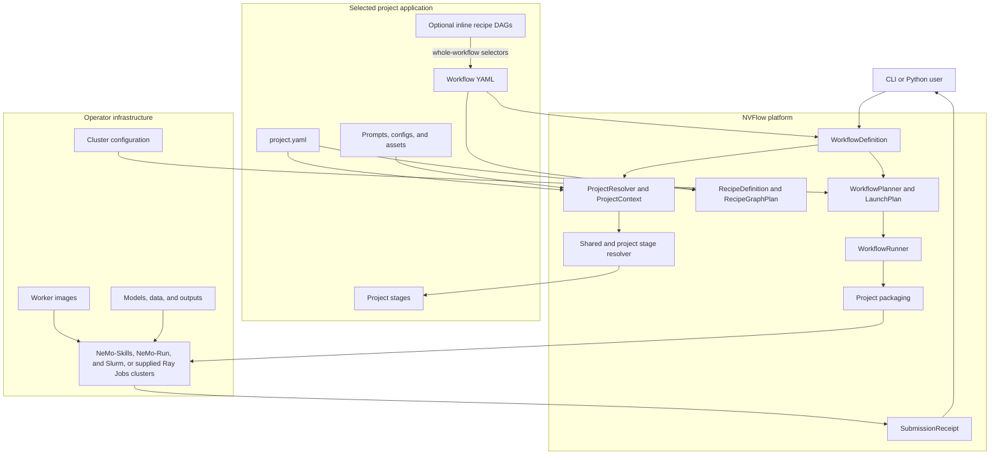
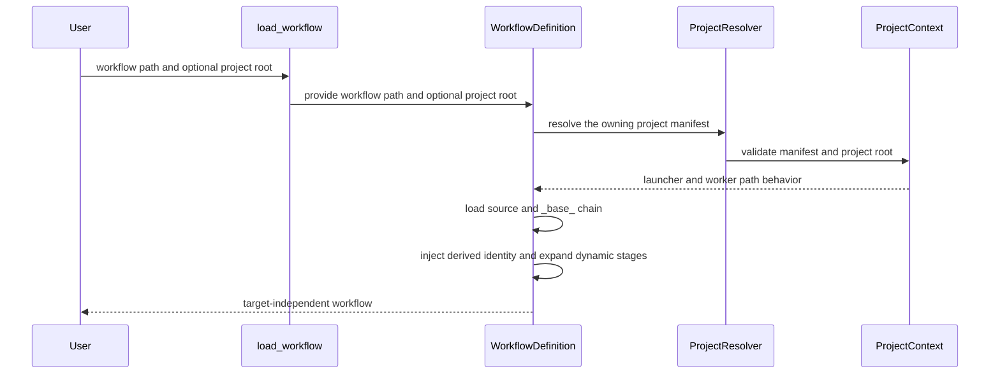
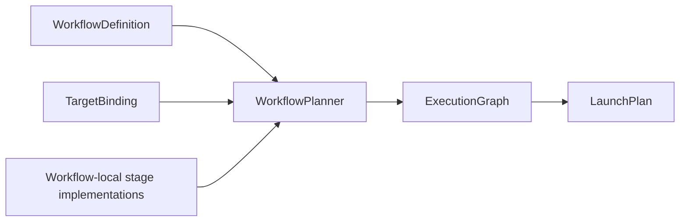
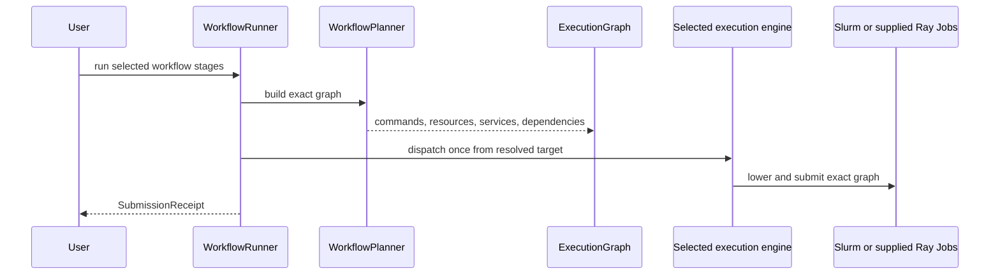

# NVFlow platform architecture

NVFlow is the workflow orchestration platform for independently owned projects.
The architecture separates platform contracts and shared stages, project
applications, recipes, and operator infrastructure.

## System boundary



## Ownership

### Platform-owned

```text
nvflow/
├── cli/           # User-facing commands and rendering
├── core/          # Target-independent workflow and stage kernel
├── execution/     # Generic planning, running, and submission
├── integrations/  # NeMo and other external framework integration
├── project/       # Project manifests, resolution, loading, and packaging
├── recipe/        # Recipe DAG definition, resolution, and graph planning
├── stages/        # Reusable cross-project stage implementations
└── utils/         # Narrow dependency-light worker utilities
```

The platform owns loading, validation, planning, packaging, execution
integration, and public contracts. It must remain independent of concrete recipe
graphs and project packages.

### Project-owned

```text
projects/my-project/
├── project.yaml
├── pyproject.toml
├── README.md
├── workflows/
├── prompts/
├── configs/
├── my_project/
├── tests/
└── docs/
```

The project owns reusable workflows, optional recipe scenarios, domain logic,
dependencies, content, documentation, and quality. Maintained projects use the
same contract as external projects. `projects/starter/` is the copyable minimal
instance; any project directory may later be backed by a Git submodule without
changing this contract.

Project launcher dependencies do not leak into the root checkout or other
projects. A copied external project may use `uv sync` to install a lightweight
bootstrap; commands that import a selected project stage prepare one full
fingerprinted environment in the user cache and transparently continue there:

```text
nvflow bootstrap (NVFlow checkout, project .venv, or client image)
    |
    +-- structural discovery (no full execution environment)
    |
    `-- selected full project environment in the NVFlow cache
            `-- all recipes, workflows, and stages in that project
```

In-repo, external, and submodule projects follow this same path. The cache is
outside each source tree and does not participate in project provenance. Each
cache entry is a synthetic uv project with its own lock and exact active NVFlow
source. Projects carry no execution lock or NVFlow policy; they may commit the
lightweight bootstrap `uv.lock` that `uv sync` creates.

### Operator-owned

```text
cluster_configs/
├── my_cluster.yaml
└── containers.yaml
```

The operator owns concrete targets, images, mounts, credentials, accounts, and
partitions.

## Load path



Loading does not submit jobs. Manifest and path validation occur before trusted
project-stage import.

## WorkflowDefinition

`WorkflowDefinition` contains:

- Source, merged, and resolved configuration
- Project and workflow identity
- Ordered pipeline stages
- Resolved `ProjectContext`
- Cluster metadata/default for programmatic callers
- Config inspection and redaction behavior

It is target-independent: an operator target is bound during planning or
execution. CLI planning and execution require an explicit `--cluster`.

## Project resolution and trust

`ProjectResolver` selects the manifest from an explicit project root, the nearest
manifest above a workflow, or a curated project source root.

`ProjectContext` provides:

- Stable project identity
- Launcher root
- Packaged worker root
- Python source roots
- `project://` validation and rendering
- Source ownership classification

Project Python is trusted application code. Semantic workflow validation and planning may
import it only after explicit selection and structural checks.

## Stage resolution

Each workflow stage binds its implementation locally:

```text
stage alias
└── uses
    ├── shared catalog type
    └── project module and class
```

Shared aliases resolve from a closed platform catalog. Project coordinates
import one `BaseStage` subclass from the selected project's Python source root.
No process-global project stage registry or import-all entrypoint participates.

## Recipe graph planning

`RecipeDefinition` is a pure project-manifest model. `resolve_recipe()` binds
each selector-keyed recipe node to one complete workflow file.
`RecipeGraphPlan` stores project-qualified selectors, deterministic dependency
order, optional markers, and project provenance.

This path remains separate from workflow execution. It does not import stage
code, bind a target, create or merge `LaunchPlan` objects, package sources, or
submit scheduler work.

## Planning



`WorkflowPlanner`:

1. Loads the selected trusted project stage namespace.
2. Validates selected stages and dependencies.
3. Renders project paths for workers.
4. Invokes each stage's mandatory exact execution contribution.
5. Produces one immutable `ExecutionGraph`.
6. Derives the redacted public `LaunchPlan` from that graph.

Opaque imperative stages are not supported. Every bundled or external runnable
stage must provide the exact execution contract.

A stage implements `BaseStage.execution()`, or subclasses one of the two bases
exported from `nvflow.execution`: `PlannedExecutionStage` returns a `StagePlan`
from `plan(context)`, and `CapturedExecutionStage` records the NeMo-Skills calls
its `build_tasks` command builder makes, as selected by `capture_strategy`.
Capture runs only during graph construction, intercepts every supported submit
call, and has no execution-engine authority.

## Execution



The direct Slurm engine is isolated under `nvflow/execution/engines/slurm.py`.
The supplied Ray engine is isolated under `nvflow/execution/engines/ray.py` and
`nvflow/integrations/ray_jobs/`. Neither engine imports or falls back to the
other. Project stages contain no backend detection; they may read
`PlanningContext.engine` and `target_gpus_per_node`, which the planner sets from
the resolved target, to shape their resource requests.

Each engine lowers the same graph with its own scheduler primitives. Direct
Slurm submits the generation tasks of each captured NeMo-Skills invocation (the
tasks that share one `generation_invocation`) once through NeMo-Skills `generate`
with its captured arguments, so NeMo-Skills keeps server/client placement, chunk
merging, and resume. The service and client commands in the plan for those tasks
are what supplied Ray runs. Both engines run the planned merge task as its own job
after the chunks; it fails when a chunk is incomplete, which NeMo-Skills' own
merge does not report.

## Packaging

The deterministic `WorkerBundle` builder:

1. Requires a clean committed project subtree.
2. Adds verified NVFlow source from the running installation, never from an
   untrusted external-project archive.
3. Archives only the selected project subtree.
4. Materializes nested project URIs and places the project at its stable
   worker destination.
5. Resolves the backend-neutral `NVFLOW_CODE_ROOT` contract in each engine.
6. Rejects unrelated, unsafe, escaping, or duplicate archive paths.

The platform wheel contains no concrete maintained project.

## Target and scheduler integration

`TargetBinding` selects one operator target. Python callers may combine
workflow target metadata/defaults with an explicit binding override. CLI
planning and execution always require `--cluster` and do not infer a target
from workflow YAML.

`engine_for()` dispatches a `ResolvedTarget` once to `DirectSlurmEngine`
(`slurm`) or `SuppliedRayJobsEngine` (`ray`). Ray targets
contain only supplied Jobs endpoints and runtime-role routes; they contain no
Slurm fields or infrastructure lifecycle behavior.

`TargetFilesystem` is the planning interface for target path inspection.
Projects never operate that filesystem directly. They declare expected paths with
`ArtifactDeclaration`, and the platform reports presence uniformly.

Direct Slurm retains NeMo-Skills/NeMo-Run lowering. Ray submission, status,
logs, cancellation, controller state, and cross-cluster dependencies are owned
by NVFlow. See the [Ray execution guide](../ray/README.md).

## Submission receipts

After submission `WorkflowRunner` returns a provider-neutral receipt containing:

- Plan digest
- Exact execution digest and engine
- Effective target
- Target fingerprint and controller handle
- Planned task identity
- Project commit, subpath, destination, and materialized content digest
- Scheduler/Jobs handles when available

The CLI uses that result internally but does not serialize it to stdout:
`nvflow run` keeps stdout empty while operator messages use
stderr.

Ray controllers additionally persist the exact graph, append-only task/attempt
events, and current state under
`<artifact-root>/.nvflow/runs/<run-id>/`.

## Compatibility surfaces

Supported project- and recipe-facing surfaces include:

- Workflow and CLI behavior
- `load_workflow` and `WorkflowDefinition`
- Project manifest, context, and resolver
- Recipe DAG definition, resolver, and graph plan
- `BaseStage.execution`, `StageExecution`, `ExecutionGraph`, and workflow-local
  stage resolution
- Curated `nvflow.integrations.nemo_gym`, `nemo_rl`, and `nemo_skills` project contracts
- Curated shared `uses` bindings and project-local class coordinates
- `nvflow.stages.sdg.document_grounded` shared stage-authoring contracts

Capture internals, integration script builders, worker entrypoints, and
project-owned utilities are not stable cross-project APIs.

## Related documentation

- [Concepts](../getting-started/concepts.md)
- [Project and recipe contract](recipe-contract.md)
- [Workflow loading and planning](workflow-and-planning.md)
- [NeMo ecosystem integrations](integrations/nemo-ecosystem.md)
- [Cluster configuration](../operations/cluster-configuration.md)
