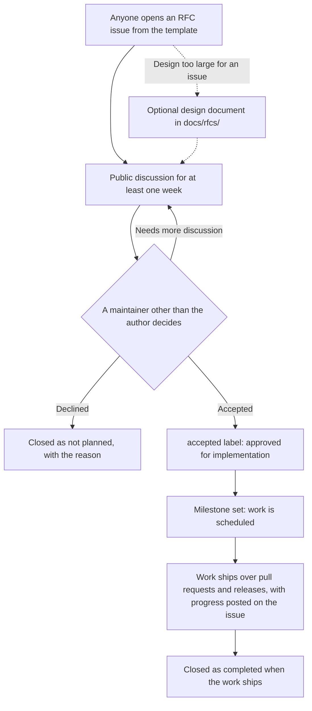

# Requests for comments (RFCs)

An RFC is a public discussion of a significant change before it is built. Open one when a change adds or alters a public contract, crosses component boundaries, creates a long-lived compatibility commitment, or would be expensive to reverse. Bug fixes, small features, and refactors that keep existing contracts need only a normal issue or pull request.

## Propose a change

Anyone can open an RFC. Use the [RFC issue template](https://github.com/NVIDIA/nvflow/issues/new?template=rfc.md) to describe the motivation, the proposed change, and the alternatives you considered. A rough proposal is fine; the discussion improves it.

Keep the issue open for feedback for at least one week, and mention the people whose input you need.

## Decision

After the feedback period, a maintainer other than the author posts the decision and its reasoning on the issue. Maintainers are the members of `@NVIDIA/nvflow-dev`.

- **Accepted:** the issue gets the `accepted` label, and the design is approved for implementation. It is scheduled once the issue has a milestone. The work can span several pull requests and releases; progress is posted on the issue, which is closed as completed when the work ships.
- **Declined:** the issue is closed as not planned, with the reason.
- **Needs more discussion:** the issue stays open.

A substantial change to an accepted design needs a new RFC that links the old one.

## Design documents

When a design is too large for an issue, add it to this directory in a pull request as `NNNN-short-title.md`, where `NNNN` is the RFC issue number, and link it from the issue. Discussion stays on the issue.

A design document starts with a link to its RFC issue and uses the template's sections: Motivation, Proposed change, and Alternatives considered. Add Compatibility and migration, and Open questions, where they apply.

RFCs already in this directory predate this process and keep their own format.
